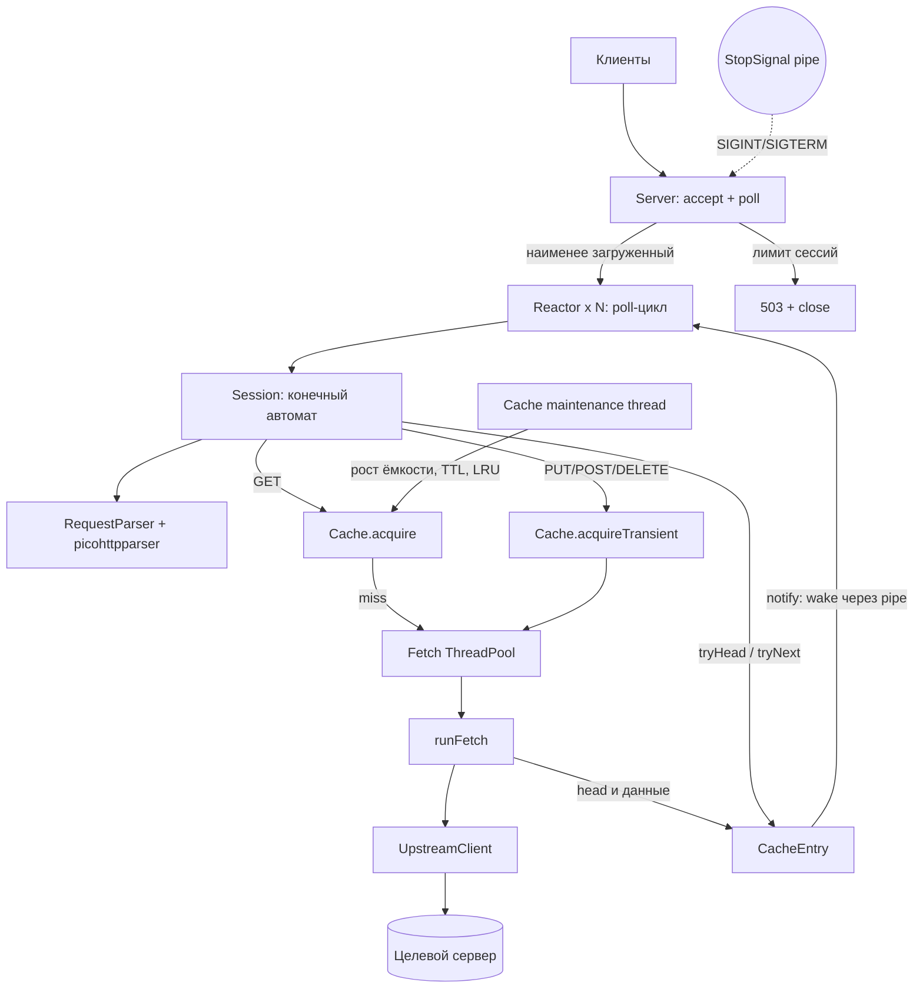

# Архитектура HTTP-прокси

## Модули

| Файлы      | Классы                                                           |
| ---------- | ---------------------------------------------------------------- |
| `Base.hpp` | ошибки, `UniqueFd`, `Platform` (Linux/macOS)                     |
| `Logger`   | `Logger`                                                         |
| `Runtime`  | `StopSignal`, `SignalHandler`, `ThreadPool`                      |
| `Net`      | `Socket` (poll + таймауты + остановка)                           |
| `Http`     | `HttpRequest`, `ResponseHead`, `RequestReader`, `UpstreamClient` |
| `Cache`    | `CacheEntry`, `EntryReader`, `Cache` (бюджет памяти, TTL, LRU)   |
| `Proxy`    | `ClientSession`, `Server`                                        |
| `Config`   | `Config`, `ConfigParser`                                         |

## Потоки

- **main**: `poll(listen, stop-fd)`, принимает соединения, выбирает reactor с минимальной нагрузкой. При превышении `--max-sessions` отвечает 503.
- **Reactor** (`--max-client-threads` штук): один `poll` на все свои сессии, wake-pipe и stop-fd. Таймаут `poll` равен ближайшему дедлайну сессии, холостых циклов нет. Одна нить обслуживает любое число сессий.
- **Session**: ReadingRequest, ReadingBody, WaitingHead, Streaming, Flushing, Done. Все операции неблокирующие, при `WouldBlock` сессия ждёт событие `poll`.
- **Fetch pool** (`2 * max-client-threads`): блокирующая загрузка с целевого сервера. Новые данные в записи кэша будят reactor сессии через callback.
- **Cache maintenance**: спит на condition variable (таймер TTL/2, не реже раза в секунду, или запрос на память) и выполняет рост ёмкости, чистку просроченных записей и LRU-вытеснение.

## Кэш

- Ключ: `http://host[:port]/path?query`. Query string входит в ключ, потому что разные query обычно дают разные ресурсы.
- Кэшируются только ответы 200 на GET. Остальные коды и методы передаются насквозь, запись из кэша убирается.
- Ресурс больше `--cache-max-size` передаётся насквозь через окно 256 КБ с обратным давлением.
- MIME-метка хранится в сериализованных заголовках ответа.
- Ёмкость растёт вдвое до `--cache-max-size`, затем вытесняется LRU. Записи с читателями или в загрузке не вытесняются.
- TTL отсчитывается с момента полной загрузки.
- Несколько клиентов на один URL ждут одну загрузку. Если один отвалился, остальные продолжают. Если отвалились все, загрузка отменяется.
