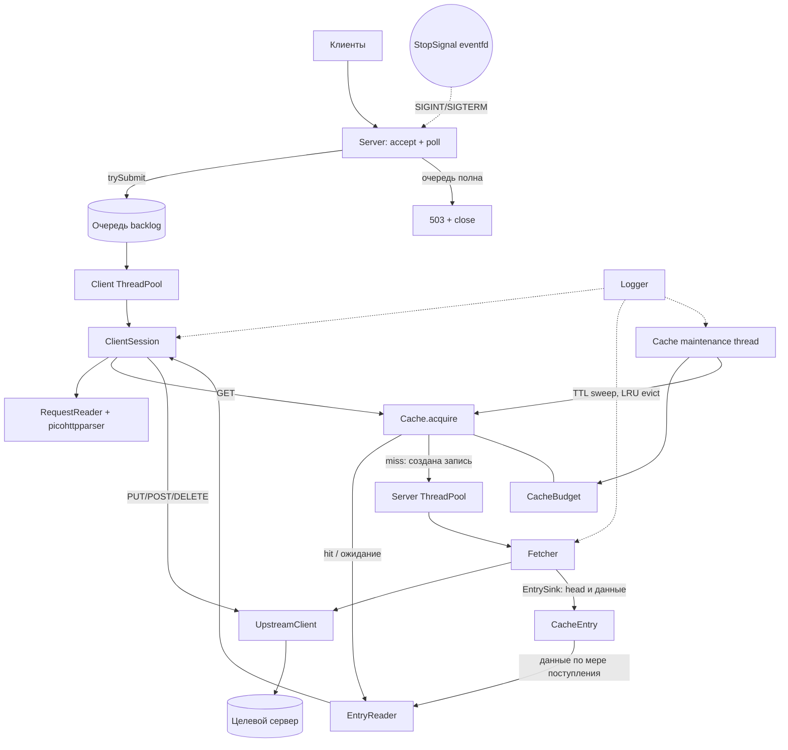

# Архитектура

## Потоки

- **main**: `poll(listen, stop-fd)`; принимает соединения и кладёт `ClientSession` в ограниченную очередь пула. Если очередь переполнена, отвечает 503 и закрывает соединение. Для EMFILE/ENFILE используется резервный fd, поэтому холостого цикла нет.
- **Client pool** (`--max-client-threads`): читает запрос, отдаёт данные клиенту. Сессий может быть больше потоков за счёт очереди.
- **Server pool**: загрузка с целевого сервера для GET. Одна запись кэша даёт один запрос на сервер.
- **Cache maintenance**: ждёт на condition variable (по давлению на память или по таймеру TTL/2, но не реже раза в секунду) и выполняет рост ёмкости, чистку просроченных записей и LRU-вытеснение.

## Кэш

- Ключ: `http://host[:port]/path?query`. Query string **входит** в ключ, потому что разные query обычно дают разные ресурсы.
- Кэшируются только ответы 200 на GET. Остальные коды и методы PUT/POST/DELETE передаются без сохранения, а запись из кэша убирается.
- Ресурс больше `--cache-max-size` передаётся насквозь: окно 256 КБ с обратным давлением, без накопления в памяти.
- MIME-метка сохраняется вместе с остальными заголовками ответа (`Content-Type` хранится в сериализованной голове ответа).
- Ёмкость растёт от `--cache-initial-size` вдвое до `--cache-max-size`, затем вытесняется LRU. Записи с активными читателями или в загрузке не вытесняются.
- TTL отсчитывается с момента полной загрузки записи.
- Несколько клиентов на один URL ждут одну загрузку и получают данные по мере их появления. Если один клиент отвалился, остальные продолжают докачку. Если отвалились все, загрузка отменяется.

## Ошибки

- 400: ошибка парсинга или заголовки больше 16 КБ.
- 408: клиент не прислал запрос за 30 с.
- 500: внутренние сбои (bad_alloc, system_error, ошибки I/O).
- 501: метод не из GET/PUT/POST/DELETE, `https://`, chunked в теле запроса.
- 502: DNS, connection refused, обрыв ответа, невалидный ответ.
- 503: переполнение очереди.
- 504: таймаут 10 с на connect, чтение или запись при обмене с целевым сервером.
- Если заголовки клиенту уже отправлены, соединение сбрасывается (RST), чтобы клиент увидел обрыв.
- Редиректы 3xx с `Location` транслируются без изменений.

## Остановка

`SIGINT`/`SIGTERM` пишут в eventfd, и все `poll` просыпаются. Порядок завершения:

1. «Received shutdown signal».
2. Закрытие listen-сокета.
3. Остановка client pool, затем «All connections closed».
4. Остановка cache maintenance.
5. Завершение server pool, затем «All threads have finished».
6. «Proxy finished».

Блокировки по условным переменным будятся через `fail()` записи в fetch-потоках.

## Известные ограничения

- Каждое соединение с клиентом обслуживает один запрос (`Connection: close`).
- `getaddrinfo` блокирующий и не прерывается по таймауту; ограничение 10 с на него не действует.
- Chunked-ответы декодируются и отдаются клиенту без длины, с завершением по закрытию соединения.
- Для GET удаляются `Range`, условные заголовки и `Accept-Encoding` (запрашивается `identity`), чтобы запись кэша была одинакова для всех клиентов.
